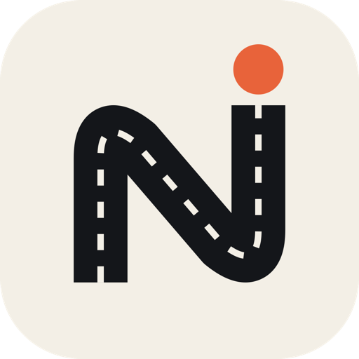
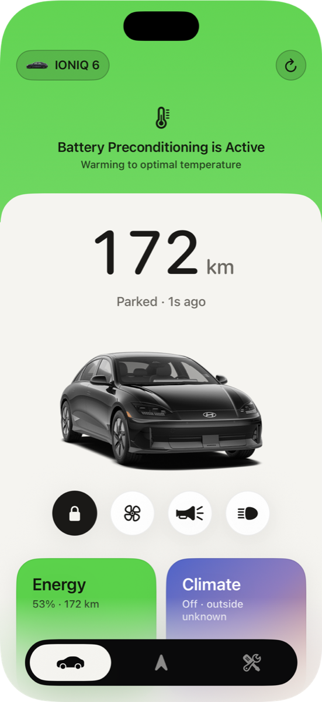
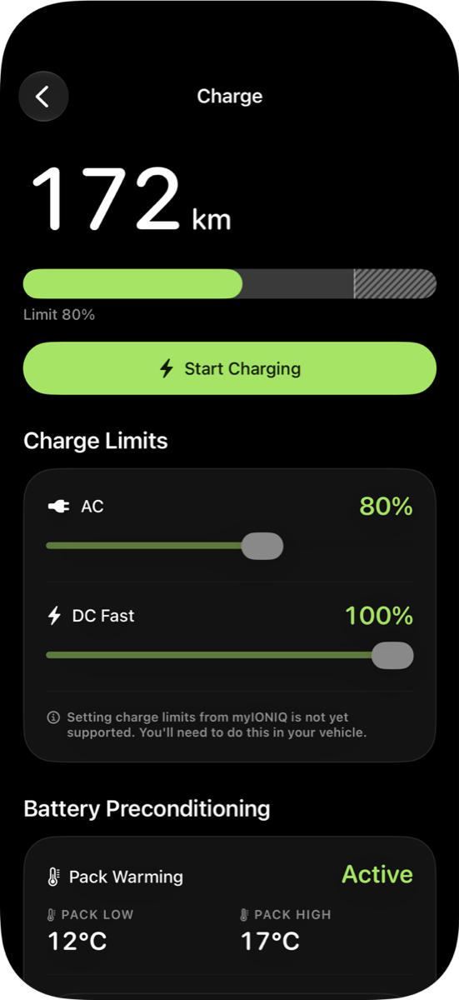
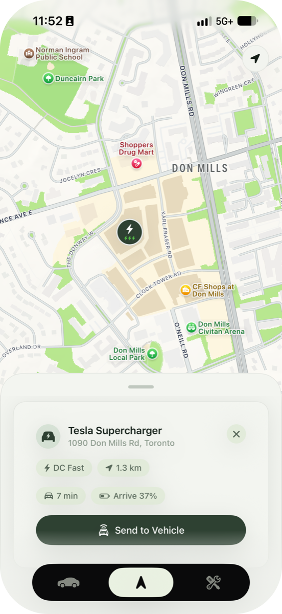
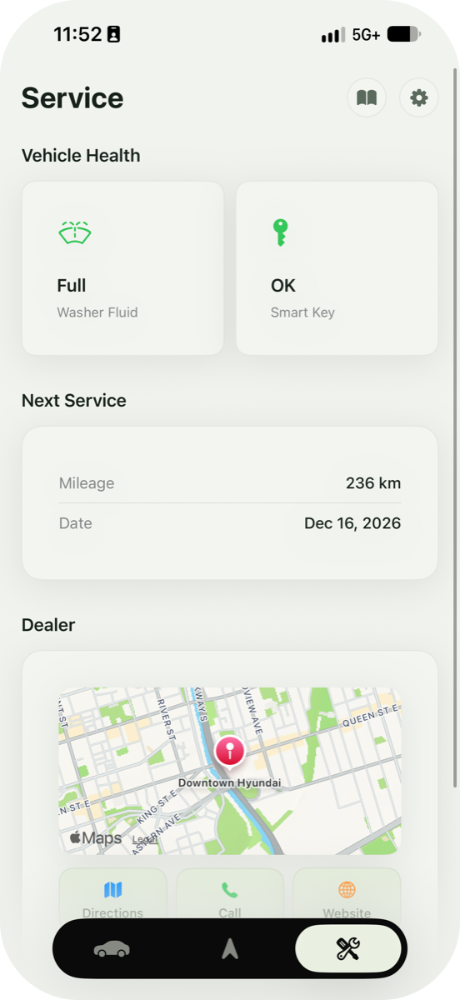
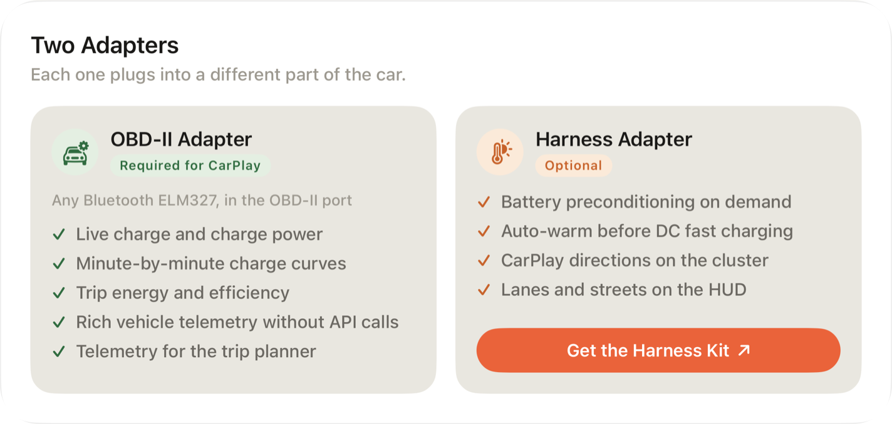
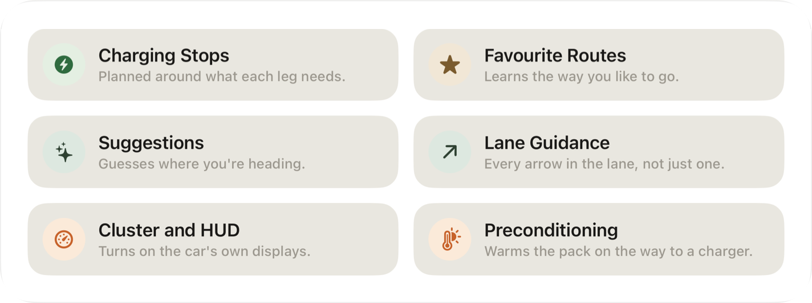

  

<h1 align="center">Numen Docs</h1>

  How Numen works under the hood. 
  Where each number comes from, what talks to what, and the parts of the car I decoded along the way.

  
  
  
  
  

  
  
  
  

Numen is an iPhone, CarPlay and Apple Watch app for Hyundai and Kia E-GMP cars. The website covers what it does. These docs cover how.

## Start Here

| Page | What It Covers |
|---|---|
| **[Architecture](docs/architecture.md)** | The app targets, how data moves between them, and which source wins when two disagree. |
| **[Privacy](docs/privacy.md)** | What leaves your phone, where it goes, and what never does. |

## Talking to the Car

  

Numen has three ways to reach the car. Bluelink works from anywhere. The OBD-II adapter reads the car directly when you're nearby. The harness adapter writes to the car's own displays.

| Page | What It Covers |
|---|---|
| **[Bluelink](docs/bluelink.md)** | Remote commands and the car's cloud status, and the quirks I work around. |
| **[OBD-II Adapter](docs/obd-adapter.md)** | Every PID the app sends, and how each one is decoded. |
| **[Harness Adapter](docs/harness-adapter.md)** | The WiCAN firmware fork: battery preconditioning, cluster directions and CAN sniffing. |
| **[Cluster and HUD](docs/cluster-and-hud.md)** | The IONIQ 6 navigation frames, byte by byte. |

## Features

  

| Page | What It Covers |
|---|---|
| **[Routing and Charging Stops](docs/routing.md)** | How a route is chosen, and how a trip gets its charging stops. |
| **[Energy Model](docs/energy-model.md)** | How Arrival SOC is worked out, and how it learns your car. |
| **[Trips and Charge History](docs/trips-and-charging.md)** | Recording drives and charges, learning your routes, and guessing where you're headed. |
| **[Apple Platforms](docs/apple-platforms.md)** | Widgets, Live Activities, Apple Watch, Shortcuts, the share sheet and walk-away locking. |

## Services

| Page | What It Covers |
|---|---|
| **[Wake-Up Service](docs/wake-up-service.md)** | Keeps Live Activities fresh while you charge. |
| **[Bug Reports](docs/bug-reports.md)** | Reporting a bug from the app. |
| **[iCloud Backup](docs/icloud-backup.md)** | Settings, history and sign-in, and how a fresh install gets them back. |

## Status

Numen is in TestFlight early access. These docs describe the current build. Anything marked **Unconfirmed** works in testing but hasn't been checked on a real drive yet.

## Built On

- [BetterBlueKit](https://github.com/JacobPantuso/BetterBlueKit) for the Bluelink client
- [wicant-i-precondition](https://github.com/L1Z3/wicant-i-precondition), the [Ioniq5_CAN](https://github.com/tylerharvey/Ioniq5_CAN) harness and [WiCAN](https://github.com/meatpiHQ/wican-fw) for the harness adapter

Numen is an independent project and isn't affiliated with or endorsed by Hyundai or Kia.

