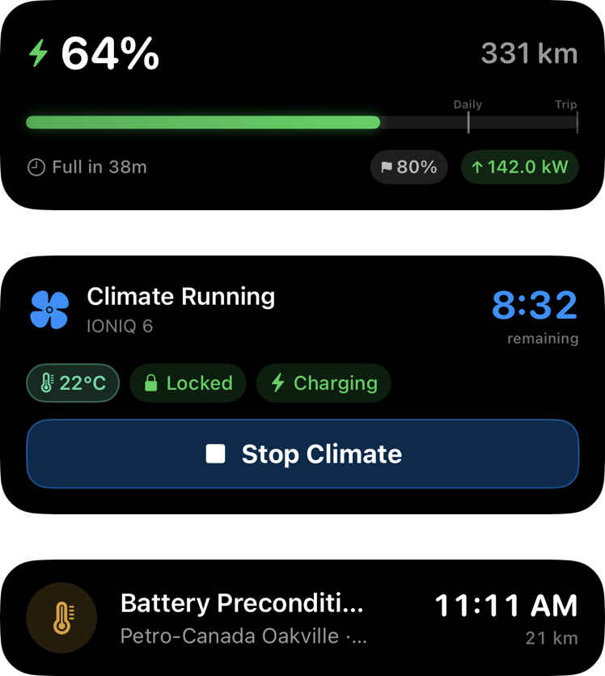

# Apple Platforms

This document covers Numen's integrations outside the main app: widgets, Live Activities, Apple Watch, Shortcuts, the share extension and walk-away locking.

None of these components contact Bluelink directly. They read the status snapshot written to the shared App Group after each refresh, and send commands through the app. See [Architecture](architecture.md#shared-storage).

## Widgets

**Vehicle Status** is available in small and medium sizes on the Home Screen, and in circular, rectangular and inline sizes on the Lock Screen. It shows SOC, range, lock state, climate and charging.

Widget buttons open `myioniq://action/<action>` to lock or unlock, toggle climate or charging, or open a specific screen.

## Live Activities

  

| Activity | Content |
|---|---|
| Charging | SOC, charge power, time to target, and the target |
| Climate | Cabin target, defrost, time remaining, and lock state |
| Charge Stop | The charger on the active CarPlay route: arrival time, distance, power, pack temperature during preconditioning, and time to target while charging |

Live Activities appear on the Lock Screen, in the Dynamic Island, on Apple Watch and in CarPlay. CarPlay presentation requires no additional configuration.

During charging, the [wake-up service](wake-up-service.md) sends a background push every 2 to 5 minutes so the app can refresh the Charging activity. While the OBD-II adapter is connected, the activity is updated from live readings instead.

## Apple Watch

The Watch app displays the same status as the iPhone and supports six commands: lock, unlock, start and stop climate, and start and stop charging.

The iPhone sends status with `updateApplicationContext` after each refresh, so the Watch has current data even when the iPhone app is not open. Commands are sent as action strings (for example `"lock"` or `"startClimate"`) and run through the same code path as the iPhone controls.

## Shortcuts

| Shortcut | Function |
|---|---|
| Lock Vehicle | Locks after the walk-away checks below. **Force Lock** bypasses them. |
| Unlock Vehicle | Unlocks the vehicle |
| Check Battery Level | SOC and range from the last status |
| Check Charging Status | Whether the vehicle is charging or plugged in |
| Check Lock Status | Locked or unlocked |
| Check Climate Status | Whether climate is running |
| Check Vehicle Status | SOC, range, current activity and location |
| Find My Car | The vehicle's last known address |
| Plan EV Trip | Opens the Trip Planner and checks whether the destination is within range |

## Walk-Away Locking

Walk-away locking is configured as a Shortcuts automation, such as on CarPlay disconnection, that runs **Lock Vehicle**. Before locking, the shortcut performs these checks in order:

| Check | Behaviour |
|---|---|
| Cooldown | An automatic lock within 60 seconds of a successful lock is skipped |
| CarPlay or vehicle audio | The lock is cancelled if either is still connected |
| Proximity beacon | If configured, waits up to approximately 30 seconds for the user to be more than 2.5 m from the vehicle |
| Vehicle state | If the OBD-II adapter is in range, waits while a door is open or the ignition is on; see [OBD-II Adapter](obd-adapter.md#doors-and-locks) |

A notification is posted whenever a lock is held; tapping it locks immediately.

### Proximity Beacon

Any iBeacon can be used, configured by UUID, major and minor values in Settings or selected from a scan.

- Distance readings are smoothed with a Kalman filter. The user is considered in the vehicle at 1.5 m or less and outside it at 2.5 m or more; the gap prevents rapid switching.
- Three consecutive readings without the beacon are treated as out of range.
- iOS suspends beacon ranging when the app is suspended, leaving the last value unchanged. The lock check does not use a stored value: it waits for a reading newer than the request, and if none arrives it defers to the vehicle state check.
- Background ranging is sustained by a low-accuracy location session, which can be disabled with **Background Ranging** in the auto-lock settings.

## Share Extension

An address, place or map link shared from another app is resolved and shown on a map for confirmation. It is then sent to CarPlay if connected, or opened in the Trip Planner. **Send to Vehicle** holds it until CarPlay next connects.

## CarPlay

Numen is a CarPlay navigation app with its own map, turn-by-turn guidance, lane guidance, speed limits and charging stops, a dashboard scene, and support for iOS 27 map panels. Routing is described in [Routing](routing.md), and cluster output in [Cluster and HUD](cluster-and-hud.md).
