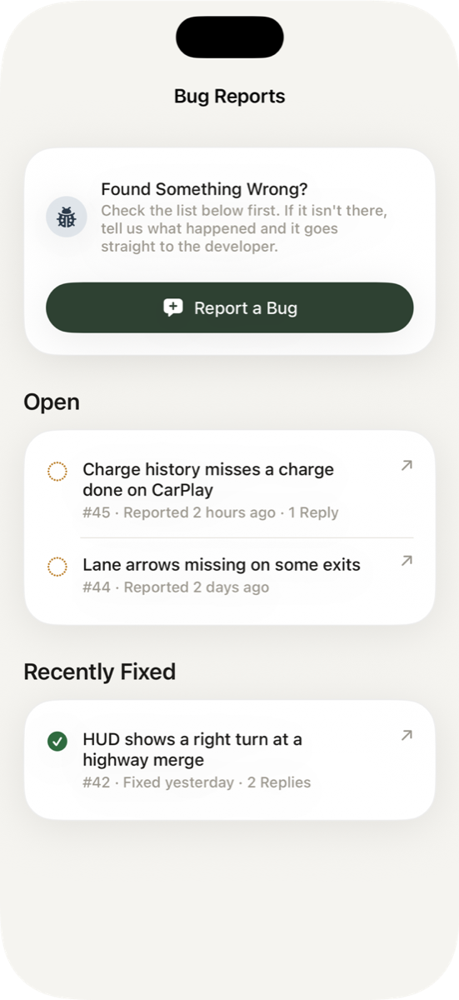

# Bug Reports

  

**Settings › Bug Reports** lists every bug reported from the app, open and recently fixed. Check there first. If yours isn't listed, tap **Report a Bug** and describe what happened.

## What's Attached

Each report includes the app and iOS version, your iPhone and car model, the state of the car and adapters when you filed it, and the app's recent activity log. That's what makes most reports fixable, so it's always attached.

## What's Removed

Before a report leaves your phone, anything that could identify you or your car is taken out. That includes your VIN, account details, email, PIN, place names, adapter names and locations.

Reports are filed as GitHub issues, so keep personal details out of the description too.
