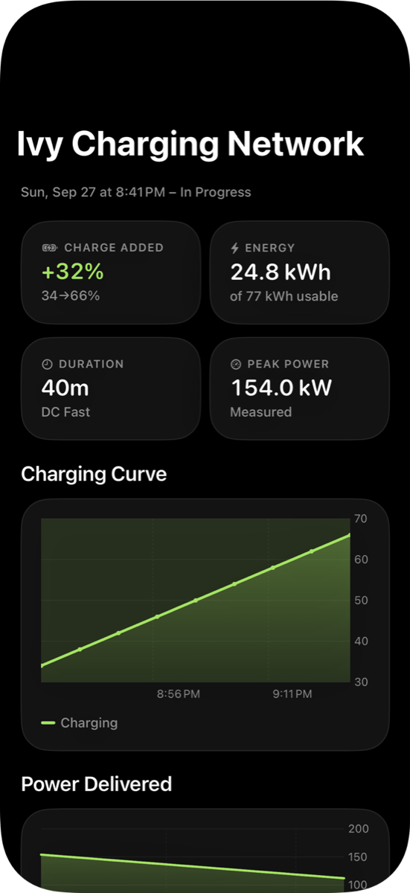

# Trips and Charge History

Bluelink Canada provides neither trip history nor charge history. Numen records both on the device.

## Trip Recording

Trips are detected from the device's speed. The OBD-II adapter is optional, and a proximity beacon indicates only that the device is near the vehicle, not that it is moving.

| Rule | Value |
|---|---|
| Monitoring | Significant-location monitoring runs continuously and relaunches the app after termination |
| Trip start | A location fix at 18 km/h or faster |
| Stopped | Below 4 km/h |
| Trip end | 3 minutes stopped |
| Minimum trip | 400 m and 90 seconds |
| Route sampling | At most one point every 10 seconds; long trips are thinned |

Network-dependent details (start and end addresses, and outside temperature from WeatherKit) are added after the trip is saved, so a failed lookup never loses a trip.

### Trip Energy

| Source | Method | Precision |
|---|---|---|
| OBD-II adapter | Change in the BMS's remaining energy | Measured |
| Bluelink | Change in reported SOC | Approximate |

Each trip records its source. Regenerative braking is derived from the BMS lifetime counters; see [OBD-II Adapter](obd-adapter.md#regenerative-braking-per-trip).

## Charge History

  

Readings from two sources are combined into sessions:

- **OBD-II adapter:** every 60 seconds while connected, and immediately when charging starts or stops.
- **Bluelink:** on each status refresh, only while the adapter is not connected, so that a cached "not charging" status cannot end an active session.

| Rule | Value |
|---|---|
| Session continuity | An active session may go up to 24 hours between readings, provided SOC has not decreased |
| Unobserved charges | An SOC increase of 5% or more between two idle readings within 18 hours is recorded as an estimated session, with an estimated duration and a minimum power |

Each session stores every reading, providing the charge curve, energy added, duration and peak power.

## Favourite Routes

Numen learns the road usually taken to frequently visited destinations.

1. Trips are grouped by origin (within 300 m) and destination (within 150 m).
2. Within a group, trips are compared on an 80 m grid. Trips sharing at least 55% of their grid cells are treated as the same road.
3. A road becomes a favourite after 4 drives on at least 2 different days, and only if it is used at least 1.5 times as often as the next alternative. Weighting decays with a 45-day half-life, and trips older than 180 days are excluded.
4. In the CarPlay route preview, a route covering at least 85% of the favourite is selected and labelled.

Two details are required for reliable matching:

- **Interpolation.** Long trips are stored with fewer points, so two recordings of the same road can differ eightfold in point spacing. Comparing recorded points alone scored identical drives at 0.27; interpolating along each segment raises this to 0.87.
- **Shared endpoints.** All routes to a destination share the final streets, which inflates similarity. The first and last 300 m are excluded from comparison.

Longitude spacing uses a single reference latitude per route, so grid cells do not drift along long drives.

## Destination Prediction

When CarPlay connects, Numen may suggest a destination based on trips that began near the vehicle's current position (within 750 m, as a trip's first recorded point is captured after the vehicle is already moving) and on the usual departure time and day.

- The same weekday carries the most weight; other weekdays carry some weight.
- Weekday and weekend trips are kept separate.

An accepted suggestion opens the route preview with the favourite road already selected.

## Trip Insights

On devices that support Apple Intelligence, the commute card generates a short summary on the device using Apple's Foundation Models: drive time, a charging note or remaining range margin, and traffic conditions. No data is sent to a server.
